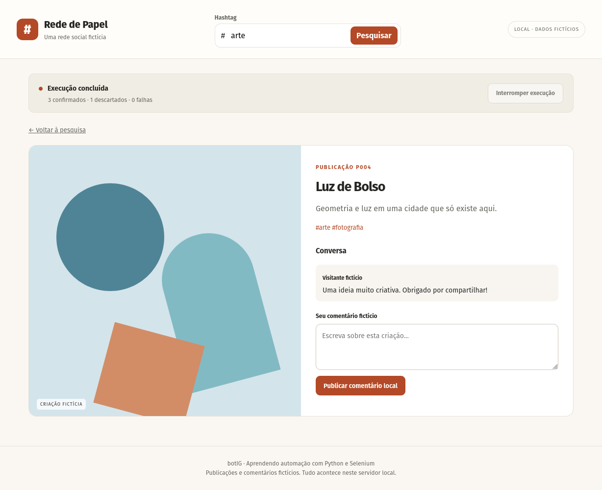
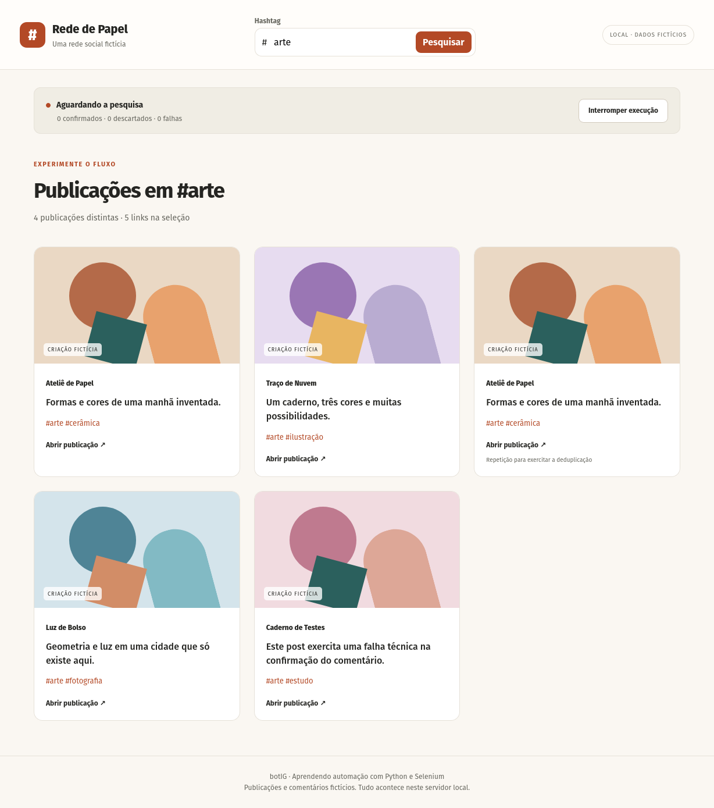

# botIG: comentários em uma rede fictícia

Um estudo de automação com Python e Selenium: pesquisar por hashtag, abrir publicações e inserir comentários, acompanhando cada interação no navegador. Ao final, o programa gera um CSV com os comentários confirmados e os demais resultados do processamento.

O projeto foi registrado no GitHub em janeiro de 2023, durante minhas primeiras automações com Python. Na experiência original, eu acompanhava a pesquisa, a abertura dos posts, a digitação e a passagem para a próxima publicação. A mudança dos seletores XPath da interface externa era uma das dificuldades. A demonstração reproduz esse percurso na **Rede de Papel**, uma pequena rede social inteiramente fictícia, servida no próprio computador.

**Fluxo:** hashtag → publicações fictícias → interação visível no Firefox → confirmação na página → CSV.



## Experimentar

Pré-requisitos: Python 3.10 ou superior, Firefox, ambiente gráfico e geckodriver compatível com o navegador. Coloque o geckodriver no `PATH` ou informe seu executável com `--driver`. O programa também reconhece drivers já disponíveis no cache do Selenium; não baixa um driver automaticamente.

Na raiz do projeto:

```bash
python3 -m venv .venv
.venv/bin/python -m pip install -r requirements.txt
.venv/bin/python igbot.py --demo --hashtag arte --limite 3 --saida outputs/demo-01.csv
```

No Windows, use `.venv\Scripts\python.exe` no lugar de `.venv/bin/python`. Se o driver não estiver no `PATH`, acrescente `--driver /caminho/para/geckodriver` ao comando. Um Firefox fora do local padrão pode ser indicado com `--firefox /caminho/para/firefox`. As variáveis de ambiente `BOTIG_DRIVER` e `BOTIG_FIREFOX` oferecem as mesmas configurações.

O comando abre um único Firefox visível e inicia o servidor somente em `127.0.0.1`, numa porta livre. Os recursos, a pesquisa e os comentários são locais. No terminal interativo, a página permanece aberta depois da execução: pressione Enter para fechar o navegador e o servidor. Use `--fechar-ao-final` para fechar automaticamente.

Sem argumentos ou com `--help`, o programa apresenta ajuda sem carregar Selenium ou abrir o navegador.

## O que acontece na demonstração

1. Selenium preenche a pesquisa e aciona o botão da interface. A busca aceita `#`, diferenças de caixa e acentos.
2. O programa lê os links retornados, aceita apenas publicações do servidor local e descarta repetições pelo ID.
3. Abre cada post, preenche um comentário fictício e aciona a publicação local.
4. Procura um comentário **novo** na página, com o texto inserido. Só então registra `Confirmado` no CSV.
5. Atualiza o progresso na página e no terminal. Cada linha é gravada imediatamente, preservando os resultados obtidos se a execução for interrompida.

O botão **Interromper execução** e `Ctrl+C` encerram o percurso. `--limite` conta publicações distintas tentadas, incluindo falhas; uma repetição descartada não consome esse limite. Por isso, o CSV pode ter mais linhas que o limite escolhido.



## Resultado gerado

Com `--hashtag arte --limite 3`, são confirmados três comentários e descartado um link repetido. A [referência CSV](examples/resultado-demo.csv) foi gerada por esse fluxo, a partir da [base fictícia](examples/publicacoes.json).

| Publicação | Hashtag | Comentário | Estado | Motivo |
|---|---|---|---|---|
| P001 | arte | Que combinação bonita de formas e cores! | Confirmado | |
| P002 | arte | Adorei os detalhes desta criação! | Confirmado | |
| P001 | arte | | Descartado | Publicação repetida na seleção. |
| P004 | arte | Uma ideia muito criativa. Obrigado por compartilhar! | Confirmado | |

O CSV usa UTF-8, separador vírgula e cabeçalhos `publicacao`, `hashtag`, `comentario`, `estado`, `motivo`, `origem` e `id_comentario`. A origem é `ficticia`; o ID do comentário permite relacionar a linha ao elemento inserido na página. A entrada permanece intacta e a saída usa um arquivo separado. Se o arquivo de saída já existir, o comando pede outro nome, sem sobrescrevê-lo.

Estados possíveis:

- **Confirmado:** comentário novo encontrado na publicação local.
- **Descartado:** link repetido, ausente ou fora dos destinos permitidos.
- **Sem resultados:** pesquisa sem publicações correspondentes; gera uma linha com motivo e sem ID de publicação.
- **Falha técnica:** problema de navegação, interação ou confirmação; não é tratado como ausência de publicação.
- **Interrompido:** publicação em processamento quando a execução foi interrompida, sem confirmação obtida.

Todos os estados se referem à rede fictícia. Comentários adicionados manualmente depois da execução aparecem na interface, mas não são acrescentados ao CSV da automação.

## Outras experiências

Use sempre um nome novo para a saída:

```bash
# Outra hashtag, com uma publicação
.venv/bin/python igbot.py --demo --hashtag natureza --limite 1 --saida outputs/natureza-01.csv

# Busca sem resultados
.venv/bin/python igbot.py --demo --hashtag semresultado --saida outputs/vazio-01.csv

# Inclui o post que exercita uma falha técnica local
.venv/bin/python igbot.py --demo --hashtag arte --limite 4 --saida outputs/falha-01.csv
```

Para modificar os dados, copie `examples/publicacoes.json` e indique a cópia com `--entrada`. Mantenha `origem: "ficticia"`, os objetos em `publicacoes` e a lista de IDs em `indice`. Cada publicação exige `id`, `autor`, `legenda` e `hashtags`; pode incluir `comentarios`, `cor` e `falha_confirmacao`. IDs são textos únicos com letras maiúsculas, números, `_` ou `-`. O índice pode repetir um ID para experimentar a deduplicação. Há seis publicações distintas na base fornecida.

Os comentários escolhidos estão em `TEXTOS`, em `automacao_local.py`, e são usados em sequência para permitir reproduzir o resultado. `--pausa` ajusta o intervalo visual entre ações, em segundos. Um novo servidor começa novamente com os comentários iniciais da base: as interações ficam em memória durante a sessão, enquanto os CSVs gerados permanecem em `outputs/`.

## Organização e decisões técnicas

- `igbot.py`: CLI, configuração e ciclo de vida da execução.
- `rede_local.py`: servidor HTTP da biblioteca padrão, pesquisa e comentários em memória.
- `automacao_local.py`: navegação Selenium, deduplicação, confirmação e exportação incremental.
- `assets/`: CSS e JavaScript locais da interface.
- `examples/`: base fictícia e CSV de referência; `outputs/`: resultados de cada execução.
- `historico/igbot.py.txt`: fonte histórica para leitura, separada do comando demonstrativo.
- `tests/test_demo.py`: verificações de entradas, limites de navegação, exportação e importação.

Os seletores da demonstração usam IDs e atributos `data-testid` definidos pela própria interface. Eles expressam a função do elemento, em vez de depender de uma sequência de classes visuais. Esse contraste permite experimentar o aprendizado do projeto original: seletores ligados à apresentação de uma plataforma externa podem mudar e quebrar a automação.

A interface é responsiva e aceita navegação por teclado. A automação Selenium requer uma sessão gráfica com Firefox; não oferece modo sem navegador. Ela segue somente os caminhos de publicação do servidor iniciado pelo programa. A base inclui uma repetição e um post de falha técnica para tornar esses tratamentos observáveis.

Autoria: Rafael Oliveira Rocha.
